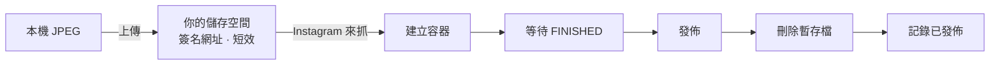

<div align="center">

# img_to_ig

**用 Instagram 官方 API 發佈照片到你自己的專業帳號**

選照片 · 發佈前預覽 · 替代文字 · 標記人 · 合作夥伴 · 單張與多張 · 自動更新


[下載](https://github.com/liaw-boy/img_to_ig/releases/latest) ·
[快速開始](#快速開始) ·
[使用方法](#使用-mac-app) ·
[API 能做與不能做](#instagram-api-能做與不能做的事) ·
[隱私與安全](#隱私與安全) ·
[疑難排解](#疑難排解)

</div>

> [!WARNING]
> **還沒有用真實的 Instagram 帳號做過端對端實測。** 核心流程與介面都有自動測試，但標記人、替代文字、合作夥伴等欄位
> 是依官方文件實作，Instagram 登入是否全部支援尚未確認。第一次發佈請先用**一張**照片，並確認預覽內容。
> 詳見〈[已知限制](#已知限制)〉。

> Instagram 是 Meta Platforms, Inc. 的商標。img_to_ig 與 Meta 沒有關係，也未獲其認可。

---

## 它是什麼

兩個工具，共用同一份設定與紀錄：

| | **Mac App** | **命令列工具 `igpub`** |
|---|---|---|
| 適合 | 一般使用者 | 想用腳本、排程的人 |
| 介面 | 設定精靈、縮圖選取、整頁預覽 | 指令列 |
| 進階欄位 | 替代文字、標記人、合作夥伴、AI 標示 | 文案、單張、多張 |
| 更新 | App 內自動更新 | 自行更新 |
| 技術 | SwiftUI，無第三方套件 | Python 標準函式庫，無第三方套件 |

**每個人用自己的 Meta App 和自己的儲存空間**，沒有中間伺服器、沒有帳號系統、不蒐集任何資料。

## 快速開始

1. **下載安裝**：到 [Releases](https://github.com/liaw-boy/img_to_ig/releases/latest) 下載 zip，解壓縮，把 `img_to_ig.app` 拖進「應用程式」。
   第一次要右鍵 → 打開（[為什麼](#下載與安裝mac-app)）。
2. **完成設定精靈**：建立 Meta App、授權你的 Instagram、設定儲存空間。（[事前準備](#事前準備帳號meta-app儲存空間)）
3. **發佈**：拖入照片 → 選取 → **預覽並發佈**。

## 運作方式

Instagram 的 API **不收本機檔案**，只會到一個公開網址去抓圖，所以需要一個暫存的儲存空間
（Cloudflare R2 這類 S3 相容服務）。檔名隨機、網址短效，發佈完（或失敗時）立刻刪除。



---

## 下載與安裝（Mac App）

需求：**macOS 14 以上**。

1. 到 [Releases](https://github.com/liaw-boy/img_to_ig/releases/latest) 下載 `img_to_ig-版本號.zip`，解壓縮，拖進「應用程式」。
2. **第一次打開會被 macOS 擋下**，因為這個 App 沒有 Apple 公證（公證需要付費的開發者計畫）。
   在 App 上按**右鍵 → 打開 → 再按「打開」**。較新的 macOS 若仍擋下，到「系統設定 → 隱私權與安全性」，最下方按「仍要打開」。
3. 之後的更新可以在 App 內完成：選單「img_to_ig → 檢查更新…」。

<details>
<summary><b>下載後請先驗證（建議）</b></summary>

App 用一張固定的自簽憑證簽章。確認你拿到的就是同一個簽章身分：

```sh
codesign -dr - /Applications/img_to_ig.app
# designated => identifier "app.imgtoig.mac" and certificate leaf = H"067394e9092297c2c4cd1a718d7aac018d2c3c37"

shasum -a 256 img_to_ig-版本號.zip       # 和 Release 頁面的 SHA-256 比對
```

`certificate leaf` 後面那串必須和上面一致，**不一致請不要打開，並回報問題**。
SHA-256 只能證明檔案沒有在下載時損毀；真正證明「是作者簽的」的是這個簽章。

</details>

---

## 事前準備：帳號、Meta App、儲存空間

這些要自己做一次，App 的設定精靈會一步一步帶你並檢查每一項。

> [!IMPORTANT]
> 所有密鑰都由你自己輸入，存進 Mac 鑰匙圈。**不要把 token 或金鑰貼給任何人。**

<details open>
<summary><b>1. Instagram 專業帳號</b></summary>

Instagram → 設定 → 帳號類型 → 切換為**商業**或**創作者**帳號。

</details>

<details>
<summary><b>2. Meta 開發者 App（約 10 個步驟）</b></summary>

到 [developers.facebook.com](https://developers.facebook.com) 登入並完成開發者註冊，然後：

| 步驟 | 做法 |
|---|---|
| 建立應用程式 | 名稱**不能含 IG、Insta、Gram、FB**（Meta 會拒絕），隨意取名並填信箱 |
| 使用案例 | 選「**管理 Instagram 的訊息和內容**」（可先用左側「內容管理」篩選） |
| 商家 | 選「我還不想連結商家資產管理組合」；要求頁沒有條件，直接下一步並建立 |
| 權限和功能 | 確認 `instagram_business_basic`、`instagram_business_content_publish` 顯示「可供測試」即可 |
| 應用程式角色 | 新增人員 → **Instagram 測試人員**，填你的 Instagram 帳號；再到 Instagram App 的「設定 → 應用程式和網站 → 測試員邀請」接受 |
| 產生權杖 | 在「含有 Instagram 登入的 API 設定」→「產生存取權杖」→「新增帳號」→「產生權杖」 |
| 授權畫面 | 只留「查看個人檔案和使用影音素材」與「**存取和發佈內容**」，其餘關閉，按「允許」 |
| 貼上 | 複製權杖，貼進 App 精靈。約 **60 天**有效，App 會提醒並可換發 |

> [!CAUTION]
> **不要按「新增到應用程式檢閱」**，那會讓帳號永久變成技術供應商，無法復原。

</details>

<details>
<summary><b>3. 儲存空間（以 Cloudflare R2 為例）</b></summary>

1. 建立一個 **bucket**（私有，不要開公開存取），例如 `photo-temp`。
2. 建立 **API 權杖**：權限選「物件讀取和寫入」，**只套用在這個 bucket**。
3. 在 App 填：
   - **Cloudflare 帳戶 ID**：32 個英數字，只填這串，網址由 App 組成
   - Bucket 名稱
   - Access Key ID、Secret Access Key
4. 精靈的「測試連線」會實際上傳一個小檔再刪掉，確認金鑰與權限正確。

</details>

---

## 使用 Mac App

### 發佈照片

| 步驟 | 說明 |
|---|---|
| **1. 加入照片** | 把 JPEG 或資料夾拖進視窗，或按「加入照片…」。同名的 `.txt` 會自動當作文案 |
| **2. 選取** | 點縮圖選取或取消；**按住 Shift 再點另一張，可連選中間所有照片**。被選到的有橘框和順序號 |
| **3. 選方式** | **單張**：每張各發一則。**多張**：選的照片合成**一則**貼文（2 到 10 張） |
| **4. 預覽並發佈** | 整頁預覽，所有貼文一次排開，可以在這裡補文案與進階設定 |
| **5. 確認** | 按「發佈」後再確認一次 |

> [!WARNING]
> 貼文發佈後立刻公開，**App 無法撤回**，只能到 Instagram 手動刪除。

### 預覽畫面

依 Instagram 貼文版型模擬：頭像列、依裁切規則裁好的照片、`1/8` 與圓點、愛心留言分享收藏列、文案、標記人與 ALT 標示。
右邊是這則貼文所有能設定的項目：

| 項目 | 說明 |
|---|---|
| 文案 | 最多 2200 字、30 個主題標籤、20 個 @提及。直接打 `#標籤`、`@帳號`；被 @ 的人會收到通知 |
| 替代文字 | 給看不到照片的人聽的描述，最多 1000 字，每張照片各自設定 |
| 標記人 | 在預覽圖上點一下放位置，填對方帳號（須是公開帳號），一張最多 20 人 |
| 合作夥伴 | 最多 3 個帳號；多張貼文設在整則上 |
| AI 生成 | 勾選會顯示「AI 資訊」標示；多張貼文設在整則上 |

> 預覽依 Instagram 的版型與裁切規則估算，**實際畫面以 Instagram 為準**。標記位置的換算要等真實發佈才能確認。

### 其他功能

- **照片規格**：只收 JPEG，單檔預設上限 8 MB（Instagram API 的限制）。比例依 4:5 到 1.91:1 裁切，多張貼文全部依第一張。
- **重複發佈保護**：以檔案內容的雜湊記錄已發佈的照片，同一張預設不勾選。
- **24 小時額度**：側邊欄顯示已發佈數量。
- **token 換發**：到期前提醒，滿 24 小時後可在 App 內換發，不用重做設定。
- **設定（⌘,）**：帳號、儲存空間、發佈預設、紀錄與隱私（含版本與更新、匯出診斷資訊、移除所有資料）。
- **自動更新**：啟動時每天最多檢查一次，可在設定關閉。有新版時在發佈畫面按「立即更新」，App 會下載、驗證、替換自己並重新開啟。

---

## 使用命令列工具

<details>
<summary><b>展開說明</b></summary>

需要 Python 3.11 以上，**只用標準函式庫**。macOS 內建的 `python3` 常是 3.9，請改用 `python3.12` 之類。

```sh
cp config.example.toml config.toml          # 填 user id、endpoint、bucket；config.toml 不會進 git
python3.12 -m igpub check                                   # 檢查設定、token、帳號與額度
python3.12 -m igpub publish ~/Pictures/out --dry-run        # 只列出會發佈什麼，不連網
python3.12 -m igpub publish ~/Pictures/out                  # 發佈資料夾裡尚未發佈的 JPEG
python3.12 -m igpub publish a.jpg --caption "木瓜山 #aviation"
python3.12 -m igpub publish 1.jpg 2.jpg 3.jpg --carousel --caption "多張"   # 2~10 張一則
```

密鑰只從**環境變數**或 **macOS 鑰匙圈**讀取（service `img_to_ig`；Mac App 存的合併項目、單筆項目、舊版 `igpub` 都讀得到），絕不放設定檔：

```sh
security add-generic-password -s img_to_ig -a access_token -w      # 會提示輸入，不會留在 shell 歷史
security add-generic-password -s img_to_ig -a s3_access_key -w
security add-generic-password -s img_to_ig -a s3_secret_key -w
```

命令列工具尚未支援替代文字、標記人、合作夥伴與 AI 標示（只有 Mac App 有）。
已發佈紀錄在 `~/.img_to_ig/published.json`，和 Mac App 共用（舊位置 `~/.igpub` 會自動搬過來）。

</details>

---

## Instagram API 能做與不能做的事

依 Meta 官方文件（2026 年 10 月查閱）整理。我們走的是「**Instagram 登入**」，不需要 Facebook 粉絲專頁。

### 能做，這個 App 已經做了

| 功能 | 說明 |
|---|---|
| 發佈單張照片 | JPEG、8 MB 以內、比例 4:5 到 1.91:1、寬 320 到 1440 像素、sRGB |
| 發佈多張貼文 | 最多 10 張，**全部依第一張的比例裁切**；算一則貼文 |
| 文案、主題標籤、@提及 | 2200 字、30 標籤、20 提及 |
| 查詢 24 小時發佈額度 | 以 API 回報為準（文件一處寫 100、另一處寫 50） |
| 換發長效 token | 需滿 24 小時 |

### 能做，已做，但**未實測**

文件沒有明確說明 Instagram 登入是否支援，需要真實帳號確認。

| 功能 | 限制 |
|---|---|
| 替代文字 | 只限圖片，1000 字 |
| 標記人 | 對方須是公開帳號；位置以 0 到 1 的比例指定；圖片必填位置 |
| 合作夥伴 | 最多 3 個；限單張、多張、Reels；限時動態不行 |
| AI 生成標示 | 文件明確標示 Instagram 登入可用；多張貼文只能設在整則上 |

### 能做，但這個 App 還沒做

| 功能 | 說明 |
|---|---|
| 限時動態（圖片） | 建議 9:16；不支援連結、投票、地點貼圖；24 小時後消失 |
| 影片、Reels | MP4/MOV，最長 15 分鐘、300 MB；可設封面、是否同步到動態、音訊名稱 |
| 發佈後開關留言 | 要多開 `instagram_business_manage_comments` 權限 |
| 讀取貼文資料 | 網址、讚數、留言數等，只需現有權限 |
| 留言管理、私訊、洞察 | 需要額外權限；超出「發佈照片」的範圍，目前不打算做 |

### 這條路線做不到

| 功能 | 原因 |
|---|---|
| **地點標記** | 要用 Facebook 粉絲專頁的 ID，並需要 `pages_read_engagement`，Instagram 登入沒有 |
| **商品標籤、廣告** | 文件寫明這個 API 設定不支援 |
| **付費合作標示** | 只限 Facebook 登入 |
| **刪除貼文** | 只有 Facebook 登入支援，所以 **App 無法撤回已發佈的貼文** |
| **編輯文案** | 發佈後文案唯讀 |
| **排程發佈** | API 沒有排程功能；要排程只能由本機到時間再發（電腦必須開著） |
| **直接上傳本機檔案** | API 只會到公開網址去抓圖，所以一定要有暫存儲存空間 |
| **濾鏡、分享到其他平台** | 不支援 |

> [!NOTE]
> 自己用時，帳號要是 App 的**測試人員**（開發模式）。要讓**不在名單裡的人**使用你的 Meta App，需要 Meta 的 App 審查，超出本專案範圍。
> 本專案的做法是**每個人建自己的 Meta App**。每個帳號每天最多建立 400 個容器；容器 24 小時沒發佈就過期。

---

## 優點與缺點

| 優點 | 缺點 |
|---|---|
| **資料都在你手上**：沒有伺服器、沒有帳號系統、不蒐集資料 | **設定繁瑣**：要自己建 Meta App、測試人員、儲存空間 |
| **用官方 API**：不是爬蟲、不需要 Instagram 密碼 | **一定要有儲存空間**：API 不收本機檔案；R2 開通要綁付款方式（有免費額度） |
| **發佈前整批預覽**：先看到裁切、文案、標記人 | **功能偏少**：沒有地點、商品標籤、排程、影片、限時動態 |
| **保護機制**：重複照片、額度顯示、失敗時刪除暫存、到期提醒 | **無法撤回**：發佈後只能到 Instagram 手動刪除 |
| **安全的更新**：只接受同一簽章身分，別人簽的、降版的都會被拒絕 | **沒有 Apple 公證**：第一次要手動放行 |
| **沒有第三方套件**：Mac App 與 Python 工具都是 | **自簽憑證**：憑證遺失或更換，所有人要手動重新安裝一次 |
| **有自動測試**：簽名、API 呼叫、錯誤處理、更新驗證 | **預覽只是模擬**，不是 Instagram 自己的畫面；**尚未真實帳號實測** |

---

## 隱私與安全

### 資料放在哪裡

| 資料 | 位置 |
|---|---|
| Instagram 權杖、儲存空間金鑰 | Mac 鑰匙圈（一個項目，service `img_to_ig`，account `bundle`） |
| 設定（帳號名稱、儲存空間網址、bucket） | `~/Library/Application Support/img_to_ig/config.json`（0600）與 App 偏好設定 |
| 已發佈紀錄（檔案雜湊、貼文編號、檔名） | `~/.img_to_ig/published.json`，權限 0600 |
| 照片 | 只在發佈期間暫存在**你自己的**儲存空間，隨機檔名，發佈完或失敗時立刻刪除 |

「設定 → 紀錄與隱私 → 移除所有資料」可清除鑰匙圈項目、設定與偏好。

### 網路連線（App 只會連到這些）

| 對象 | 用途 |
|---|---|
| `graph.instagram.com` | 發佈與查詢。**權杖只會送到這裡**，程式每次請求前檢查主機白名單 |
| 你自己的 R2 網址 | 上傳與刪除暫存照片 |
| `api.github.com`、`github.com`（及其下載網域） | 檢查與下載更新，不送出任何帳號、照片或權杖 |

只允許 https、不跟隨轉址（更新下載只允許轉到 GitHub 的網域）。沒有任何分析或回報。

### 自動更新的安全設計

更新只有在**全部**符合時才會安裝：

1. 版本號比現在新
2. 下載網址在白名單內
3. 檔案大小與 SHA-256 吻合
4. 壓縮檔內容只有一個 `img_to_ig.app`，且沒有指向外部的連結，解壓大小有上限
5. **簽章符合目前這個 App 的簽章規則**（相同 App 識別碼與相同簽章憑證）

任何一項不符就停止，不會動到目前的 App。

<details>
<summary><b>為什麼鑰匙圈會問你兩次？</b></summary>

macOS 對「簽章身分和建立項目時不同的 App」，讀取時會跳出兩個授權視窗，這是系統規則。
按「永遠允許」之後，同一個簽章身分的版本（包含自動更新後的版本）不會再問。
你輸入的是你的 Mac 登入密碼，App 拿不到它。

</details>

回報安全問題請見 [SECURITY.md](SECURITY.md)。

---

## 疑難排解

<details>
<summary><b>展開常見問題</b></summary>

| 現象 | 原因與處理 |
|---|---|
| App 打不開、說無法驗證開發者 | 沒有 Apple 公證。右鍵 → 打開，或到「系統設定 → 隱私權與安全性」按「仍要打開」 |
| Meta 說 App 名稱不能用 | 名稱不能含 IG、Insta、Gram、FB |
| 測試連線說權杖無效 | 權杖過期或貼錯。回 Meta 後台重新「產生權杖」，舊的會失效 |
| 說缺少權限 | 授權時漏選「存取和發佈內容」。重新產生權杖並勾選 |
| 照片被略過 | 不是 JPEG，或超過 8 MB。目前需要自己先縮小 |
| 儲存空間測試失敗 | 帳戶 ID 不是 32 個英數字，或 API 權杖沒有套用到這個 bucket |
| 發佈後貼文被裁切 | Instagram 只收 4:5 到 1.91:1，多張貼文依第一張裁切；預覽畫面可以先看到 |
| 檢查更新沒有反應或找不到 | 網路問題，或還沒有發佈過版本 |
| 每次重新建置都要重新授權鑰匙圈 | 開發時才會發生，請用固定憑證簽章（見〈開發者〉） |

</details>

## 已知限制

- **尚未用真實 Instagram 帳號做過端對端測試。** 端點與參數依官方文件撰寫，目前只用假的網路回應測試。
- 標記人的座標是否以「裁切後的畫面」為基準，文件沒有明講，要實測確認。
- Meta 後台常改版，精靈中的按鈕名稱可能與你看到的不同。
- 照片超過 8 MB 目前會被略過，還沒有自動縮小。

---

## 開發者

```sh
cd IGPubApp
./scripts/verify.sh        # 編譯、單元測試、密鑰掃描、簽章檢查、啟動測試（提交前必跑）
./scripts/build_app.sh     # 產出 build/img_to_ig.app
./scripts/release.sh       # 打包 dist/img_to_ig-版本.zip 與 SHA-256（不會自己上傳）
```

```sh
python3.12 -m unittest discover -s tests -t .     # Python 測試
```

- **簽章憑證**：`build_app.sh` 會用登入鑰匙圈裡名為 `img_to_ig Release Signing` 的憑證簽章；找不到時退回臨時簽章。
  自動更新要求新舊版是同一個簽章身分，所以**請務必備份這張憑證（連同私鑰，加密後離線保存），且絕不放進 git、CI 或雲端硬碟**。
- 版本號在 `IGPubApp/VERSION`，發佈用的 git 標籤是 `v版本號`，資產名稱必須是 `img_to_ig-版本號.zip`。
- 鑰匙圈 service（`img_to_ig`）與紀錄檔路徑（`~/.img_to_ig/published.json`）由 App 與命令列工具共用，兩邊必須一致。
- 所有網路請求都要走注入的 `HTTPClient`（Swift）或 `net.http`（Python），測試才能用假回應取代。

## 授權

尚未選定授權。在加上 LICENSE 檔之前，依法預設保留所有權利。
